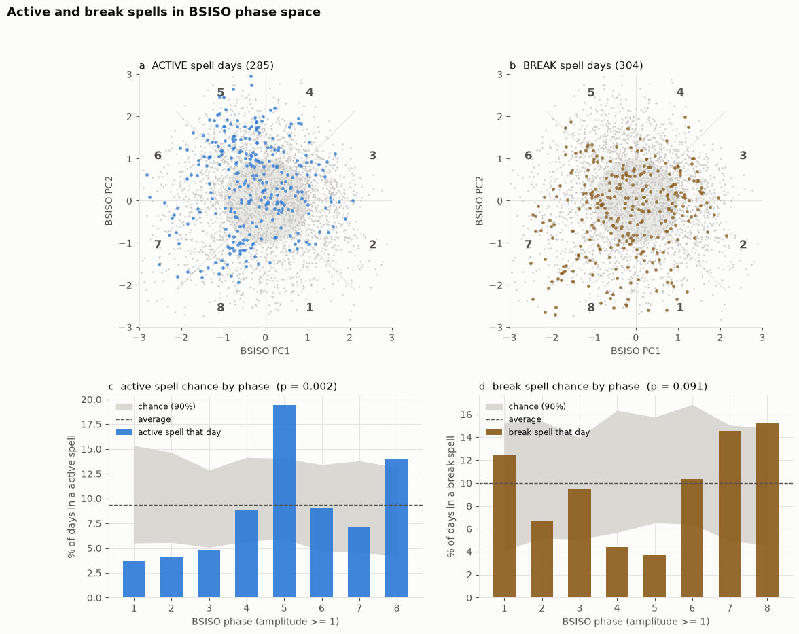
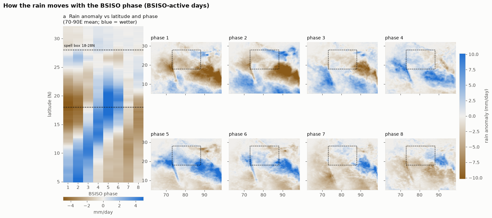
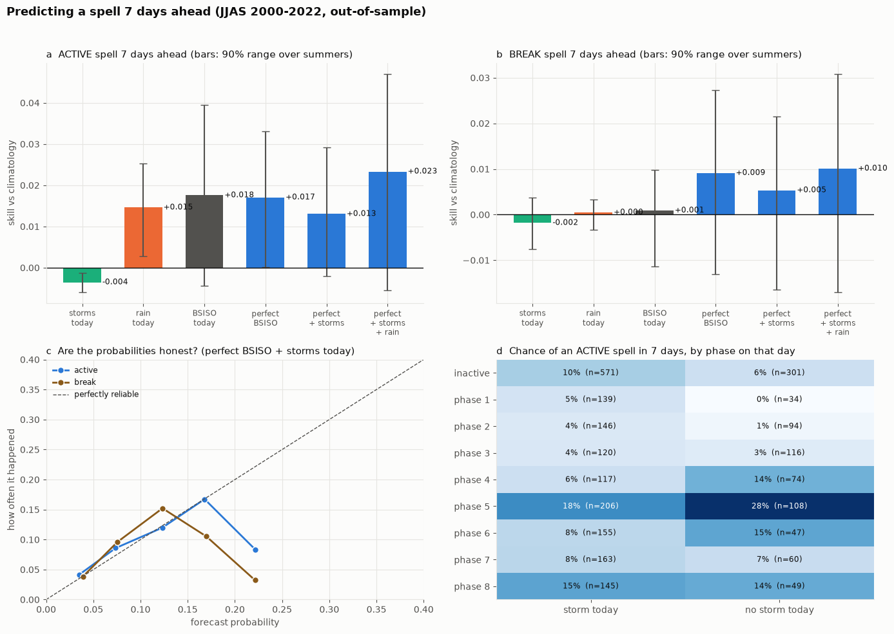
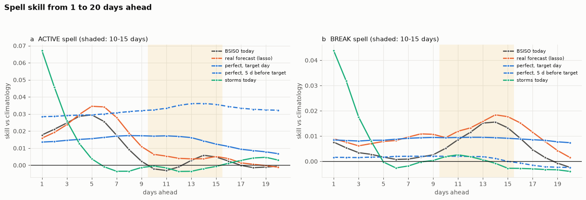
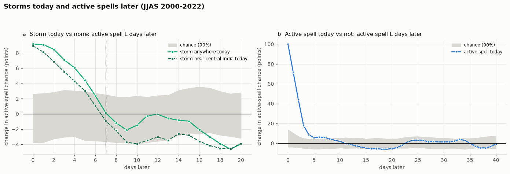

# BSISO and active/break rainfall spells: what the numbers say

Companion to [`bsiso_active_link.ipynb`](bsiso_active_link.ipynb) (a Kaggle notebook).
Season analysed: June-September (JJAS). Spells use 2000-2024; anything involving storms uses 2000-2022,
the years covered by the storm catalogue.

Every number below is printed by the notebook.

---

## 1. The result in one paragraph

Active rainfall spells over central India are clearly tied to the BSISO phase: they are twice as common
in phase 5 as on an average day. The BSISO also helps forecast a spell a week or more ahead, but the gain
is small. For active spells 10-15 days ahead, the best any BSISO forecast could do is set by the true
BSISO about 5 days before the target day. Today's statistical (lasso) forecast recovers only a small part
of that. Break spells can already be forecast as well from today's BSISO as from a perfect one. Storms
only help for the next few days, and the idea that "no storm today means an active spell next week" did
not hold up.

### What is supported, and what is not

| claim | key number | verdict |
|---|---|---|
| Active spells favour BSISO **phase 5** | 19.4% of phase-5 days are active vs 9.3% overall; pattern p = 0.002 | **strong** |
| Break spells favour phases 7-8 | 14.6% and 15.2% vs 10.0% overall; pattern p = 0.091 | **weak**, not significant |
| The rain band **moves north** with the phase | wettest latitude (70-90E) about 5N in phases 1-2, 19N in phases 5-6 | **clear** |
| The BSISO predicts an active spell **7 days ahead** | skill +0.017 (perfect BSISO), p = 0.005; today's BSISO already gives +0.018 | **real but small** |
| Storms add skill beyond the BSISO at 7 days | gain -0.004, p = 0.80 | **not supported** |
| Active spells **10-15 days ahead**: room for a better BSISO forecast | ceiling +0.035 (true BSISO 5 d before target) vs +0.005 (lasso) | **yes, this is the gap to close** |
| Break spells 10-15 days ahead | today's BSISO +0.012 already matches perfect +0.009 | **no room to improve** |
| Weekly rain anomaly 10-15 days ahead | correlation 0.30 (perfect) vs 0.22 (lasso) vs 0.17 (today) | **supported** |
| "No storm today -> active spell in a week" | phase 5: 28% vs 18%; p = 0.32 | **not supported** |

---

## 2. Data and terms

| dataset (Kaggle) | file | contents |
|---|---|---|
| IMERG rainfall | `imerg_india_025_jjas_2000_2024.nc` | daily rain (mm/day), 0.25 degree, 5-40N, 60-100E, 3,050 JJAS days |
| BSISO index | `BSISO.INDEX.NORM.LY.data` | daily BSISO PC1, PC2, 1981-2026 (APCC index, Lee et al. 2013) |
| LPS tracks | `lps_daily_2000_2022.parquet` | 2,232 storm-days from 345 storms, JJAS 2000-2022 |
| lasso BSISO forecasts | `lasso_bsiso_forecasts.parquet` | out-of-sample BSISO forecasts, 1-20 days ahead (rebuilt by the notebook if not attached) |

The data files are not stored in this repository. The India land mask is embedded in the notebook.

| term | meaning |
|---|---|
| **active / break spell** | central-India land rain (18-28N, 73-88E) at least 1 standard deviation above / below that calendar day's average, for 3 or more days in a row |
| **phase** | one of 8 sectors of the (PC1, PC2) plane, `atan2(PC1, -PC2)`; phases 4-6 = wave over India |
| **BSISO-active** | amplitude >= 1. Not the same as an active *rainfall* spell |
| **skill** | Brier skill score against climatology: 0 = no better than always forecasting the average rate, higher is better |
| **perfect BSISO** | the true BSISO on the target day, an upper limit for any BSISO forecast |
| **perfect, 5 d before target** | the true BSISO 5 days before the target day (rain responds a few days after the BSISO) |
| **real forecast (lasso)** | an out-of-sample statistical BSISO forecast |
| **top-10% rate** | how often a spell actually happened on the 10% of days with the highest forecast probability |

---

## 3. How to read the statistics

- **Out-of-sample.** Every forecast is tested on one summer held out at a time. The spell labels are
  rebuilt without that summer too, so nothing about the test year leaks into training.
- **p-values come from re-dating whole seasons** (shuffling which summer goes with which BSISO record),
  never from textbook formulas. p = 0.01 means only 1% of shuffles did as well.
- **"90% range over summers"** is a bootstrap over years: how much the skill would change with a
  different set of summers.
- The skill numbers look small (+0.02 to +0.04) because spells are rare (about 10% of days). What matters
  is whether they beat chance and how they compare with each other.

---

## 4. Results

### 4.1 Spell labels

| JJAS 2000-2024 | days | share |
|---|---|---|
| active | 285 | 9.3% |
| break | 304 | 10.0% |
| neutral | 2,461 | 80.7% |

The rebuilt labels agree with the project's stored labels on 100% of days.

### 4.2 Spells in BSISO phase space

| BSISO phase | days | active | chance range | break | chance range |
|---|---|---|---|---|---|
| inactive (amp < 1) | 1,008 | 9.3% | 7-11% | 11.4% | 8-12% |
| 1 | 216 | 3.7% | 6-15% | 12.5% | 4-15% |
| 2 | 267 | 4.1% | 6-15% | 6.7% | 5-15% |
| 3 | 273 | 4.8% | 5-13% | 9.5% | 5-14% |
| 4 | 227 | 8.8% | 6-14% | 4.4% | 6-16% |
| **5** | 350 | **19.4%** | 6-14% | 3.7% | 7-16% |
| 6 | 232 | 9.1% | 5-13% | 10.3% | 6-17% |
| 7 | 240 | 7.1% | 5-14% | 14.6% | 5-15% |
| 8 | 237 | 13.9% | 4-13% | 15.2% | 5-15% |

Pattern across phases 1-8: active p = 0.002, break p = 0.091.

Phase 5 is the only phase clearly outside the chance range for active spells. Phases 1-3 sit at the low
end. Breaks lean towards phases 7-8, but not beyond chance.

### 4.3 How the rain moves with the phase

| BSISO phase | wettest latitude (70-90E) | rain anomaly there |
|---|---|---|
| 1 | 5.0 N | +2.9 mm/day |
| 2 | 5.2 N | +5.1 mm/day |
| 3 | 10.8 N | +4.5 mm/day |
| 4 | 13.5 N | +4.5 mm/day |
| 5 | 19.0 N | +6.8 mm/day |
| 6 | 19.2 N | +4.3 mm/day |
| 7 | 28.8 N | +0.3 mm/day |
| 8 | 23.8 N | +0.9 mm/day |

The rain band starts near the equator and reaches central India (the spell box, 18-28N) in phases 5-6,
when it is also strongest. This is why phase 5 holds the active spells.

### 4.4 Predicting a spell 7 days ahead

| 7 days ahead | ACTIVE skill | ACTIVE top-10% rate | BREAK skill | BREAK top-10% rate |
|---|---|---|---|---|
| climatology | 0 | 9% | 0 | 11% |
| storms today | -0.004 | 7% | -0.002 | 8% |
| rain today | +0.015 | 14% | +0.000 | 9% |
| BSISO today | +0.018 | 21% | +0.001 | 5% |
| perfect BSISO | +0.017 | 18% | +0.009 | 13% |
| perfect BSISO + storms today | +0.013 | 16% | +0.005 | 9% |
| perfect BSISO + storms + rain today | +0.023 | 20% | +0.010 | 15% |

Does each ingredient beat chance? (200 season re-datings)

| test | active gain | p | break gain | p |
|---|---|---|---|---|
| perfect BSISO | +0.017 | 0.005 | +0.009 | 0.020 |
| perfect BSISO, given storms | +0.017 | 0.005 | +0.007 | 0.030 |
| storms, given perfect BSISO | -0.004 | 0.80 | -0.004 | 0.73 |
| storms alone | -0.004 | 0.86 | -0.002 | 0.49 |

The BSISO gives real skill at 7 days. Today's BSISO is as good as a perfect forecast for active spells,
because the BSISO moves slowly enough that today's phase still points a week ahead. Storms today add
nothing at this lead.

### 4.5 Further ahead: 1-20 days

ACTIVE skill by days ahead:

| | 1 d | 3 d | 5 d | 7 d | 10 d | 12 d | 15 d | 20 d |
|---|---|---|---|---|---|---|---|---|
| BSISO today | +0.018 | +0.025 | +0.029 | +0.018 | -0.002 | -0.001 | +0.005 | -0.001 |
| real forecast (lasso) | +0.016 | +0.024 | +0.035 | +0.028 | +0.006 | +0.004 | +0.005 | -0.001 |
| perfect, target day | +0.014 | +0.015 | +0.016 | +0.017 | +0.017 | +0.017 | +0.012 | +0.007 |
| perfect, 5 d before target | +0.028 | +0.029 | +0.029 | +0.031 | +0.032 | +0.035 | +0.036 | +0.032 |
| storms today | +0.067 | +0.026 | +0.004 | -0.004 | -0.000 | -0.004 | -0.001 | +0.003 |
| rain today | +0.281 | +0.024 | +0.011 | +0.015 | +0.000 | -0.001 | -0.001 | -0.002 |

BREAK skill by days ahead:

| | 1 d | 3 d | 5 d | 7 d | 10 d | 12 d | 15 d | 20 d |
|---|---|---|---|---|---|---|---|---|
| BSISO today | +0.008 | +0.003 | +0.002 | +0.001 | +0.005 | +0.012 | +0.013 | -0.002 |
| real forecast (lasso) | +0.009 | +0.006 | +0.008 | +0.010 | +0.009 | +0.013 | +0.018 | +0.002 |
| perfect, target day | +0.008 | +0.008 | +0.008 | +0.009 | +0.009 | +0.010 | +0.009 | +0.007 |
| perfect, 5 d before target | +0.002 | +0.001 | +0.002 | +0.002 | +0.002 | +0.002 | -0.000 | -0.002 |
| storms today | +0.044 | +0.018 | -0.000 | -0.002 | +0.002 | +0.002 | -0.003 | -0.004 |
| rain today | +0.369 | +0.068 | +0.011 | +0.000 | -0.001 | -0.001 | -0.003 | -0.002 |

Average over 10-15 days, and whether it beats chance (100 season re-datings):

| 10-15 days ahead | active skill | p | active top-10% | break skill | p | break top-10% |
|---|---|---|---|---|---|---|
| perfect, target day | +0.016 | 0.01 | 16% | +0.009 | 0.02 | 13% |
| **perfect, 5 d before target** | **+0.035** | 0.01 | **24%** | +0.001 | 0.14 | 5% |
| real forecast (lasso) | +0.005 | 0.04 | 14% | +0.014 | 0.02 | 12% |
| BSISO today | +0.001 | 0.06 | 13% | +0.012 | 0.01 | 8% |
| perfect 5 d before, given today | +0.029 | 0.01 | | -0.001 | 0.19 | |
| real forecast, given today | -0.001 | 0.17 | | -0.001 | 0.21 | |
| (average rate) | | | 9% | | | 11% |

- **Active spells:** a perfect BSISO 5 days before the target gives +0.035, and on its best 10% of days
  an active spell follows 24% of the time (vs 9% on average). The current lasso forecast gets +0.005.
  This gap is what a better BSISO forecast (the planned transformer) would try to close.
- **Break spells:** today's BSISO and the lasso forecast already match a perfect one, so a better BSISO
  forecast would not help breaks.

### 4.6 Weekly rain anomaly

Target: the 7-day mean rain anomaly around the target day. Out-of-sample correlations.

| | 3 d | 5 d | 7 d | 10 d | 12 d | 15 d | 17 d |
|---|---|---|---|---|---|---|---|
| BSISO today | 0.31 | 0.28 | 0.23 | 0.15 | 0.16 | 0.21 | 0.22 |
| real forecast (lasso) | 0.31 | 0.31 | 0.29 | 0.23 | 0.21 | 0.22 | 0.21 |
| perfect, target day | 0.30 | 0.30 | 0.30 | 0.30 | 0.30 | 0.30 | 0.29 |
| perfect, 5 d before target | 0.28 | 0.28 | 0.28 | 0.28 | 0.28 | 0.29 | 0.28 |

| 10-15 days ahead | correlation | chance (95%) | p |
|---|---|---|---|
| BSISO today | 0.17 | 0.02 | 0.01 |
| real forecast (lasso) | 0.22 | 0.03 | 0.01 |
| perfect, target day | 0.30 | 0.01 | 0.01 |
| perfect, 5 d before target | 0.28 | 0.01 | 0.01 |

All beat chance. Weekly rain is a smoother target than yes/no spells and shows the same ordering:
perfect > lasso > today.

### 4.7 Storms today and spells later

Change in the chance of an active spell L days later, storm today vs no storm (percentage points):

| days later | storm anywhere | storm near central India | chance (90%) |
|---|---|---|---|
| 0 | +9.1 | +8.9 | -3.8 to +2.6 |
| 2 | +8.5 | +6.9 | -3.3 to +2.8 |
| 4 | +6.0 | +4.3 | -3.0 to +3.0 |
| 6 | +2.4 | +1.1 | -3.5 to +2.7 |
| 7 | +0.1 | -0.9 | -3.6 to +2.5 |
| 10 | -1.5 | -3.9 | -3.9 to +2.3 |
| 14 | -0.8 | -2.6 | -2.8 to +3.1 |
| 20 | -3.9 | -3.9 | -3.2 to +2.8 |

A storm today raises the chance of an active spell for about 4-5 days, and the effect is gone by day 7.

Active spell 7 days later, split by today's state:

| today | storm today | no storm today | days with a storm |
|---|---|---|---|
| active | 11.9% (n = 219) | 37.0% (n = 27) | 89% |
| neutral | 9.2% (n = 1,464) | 10.1% (n = 690) | 68% |
| break | 5.1% (n = 79) | 0.6% (n = 166) | 32% |

The striking "37%" comes from only 27 days, so it says little.

**"No storm today -> active spell a week later" (phase 5 on the target day):** +9.8 points, but chance
alone gives up to +17.7 (95%), p = 0.32. **Not supported.**

Adding storms to the 7-day forecast: active +0.025 -> +0.023, break +0.011 -> +0.010. No gain.

---

## 5. Key results

| result |
|---|
| Active spells peak in BSISO phase 5 (19% of days vs 9% average); pattern p = 0.002 |
| Break spells lean to phases 7-8; pattern p = 0.091 (not significant) |
| The rain band marches north with the phase: ~5N (phases 1-2) to ~19N (phases 5-6) |
| 7 days ahead, perfect BSISO: skill +0.017 active, +0.009 break; BSISO today already gives +0.018 active |
| Storms today help only 1-4 days ahead (skill +0.067 at 1 day, -0.004 at 7) |
| 10-15 days, active: ceiling (perfect BSISO 5 d before target) +0.035; lasso +0.005; BSISO today +0.001 |
| 10-15 days, break: BSISO today +0.012 already matches perfect +0.009 |
| Weekly rain anomaly, 10-15 days: correlation 0.30 (perfect) vs 0.22 (lasso) |
| "No storm today -> more active spells in 7 days" (phase 5): not significant, p = 0.32 |

---

## 6. What this means for the next step

A BSISO forecast is only worth improving for **active spells 10-15 days ahead**. There, the target to
beat is the lasso forecast (+0.005), and the ceiling is +0.035. The most useful thing to predict is the
BSISO about 5-10 days ahead, because the rain over central India follows the BSISO by about 5 days.
Storms are useful only for the first few days and do not need forecasting for this purpose.
