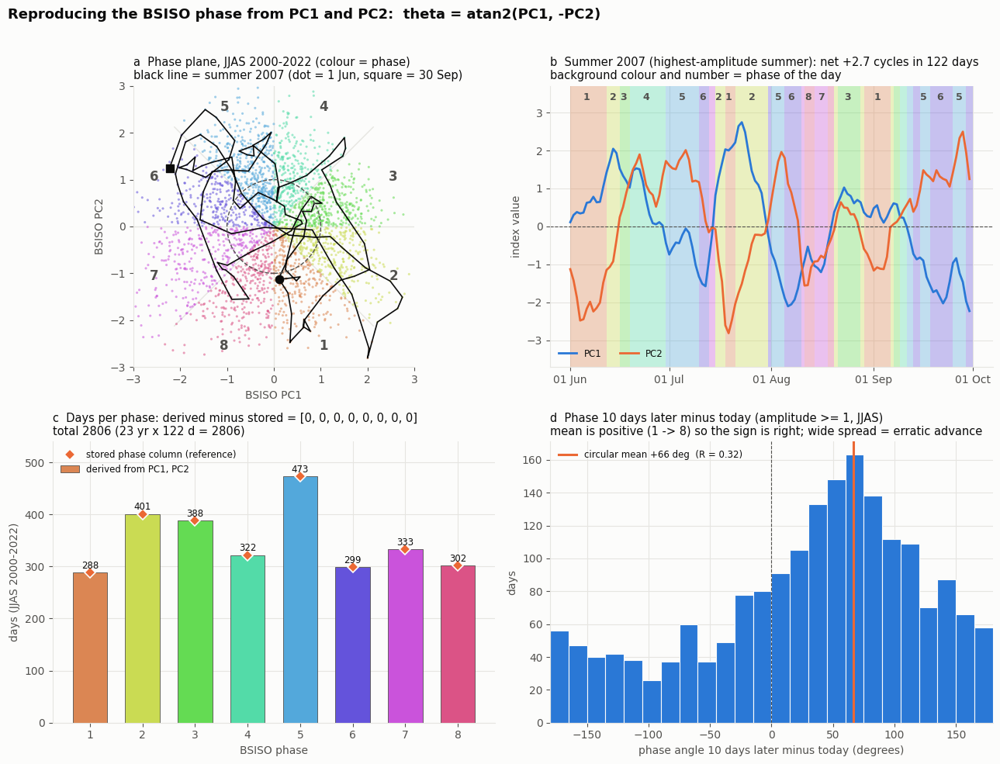
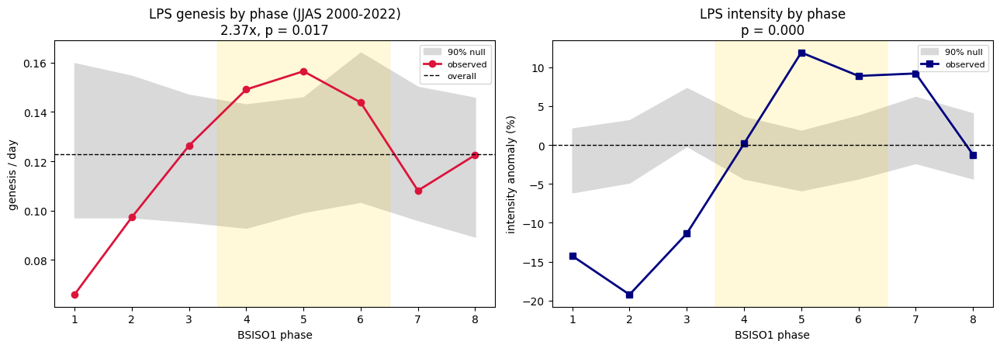
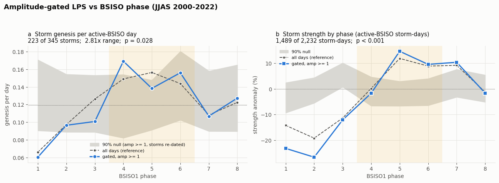
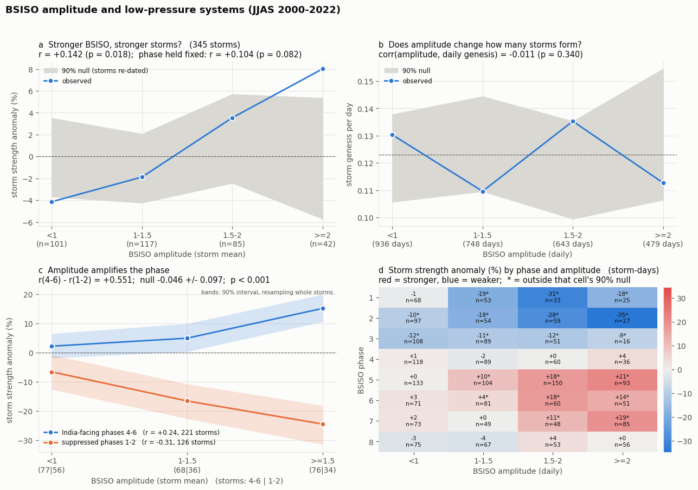
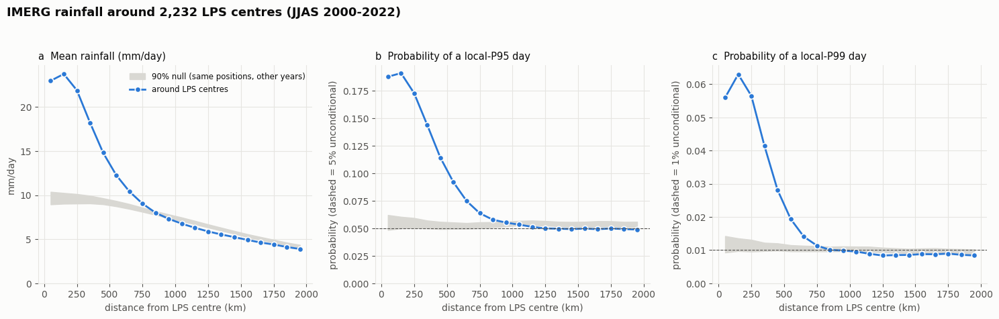
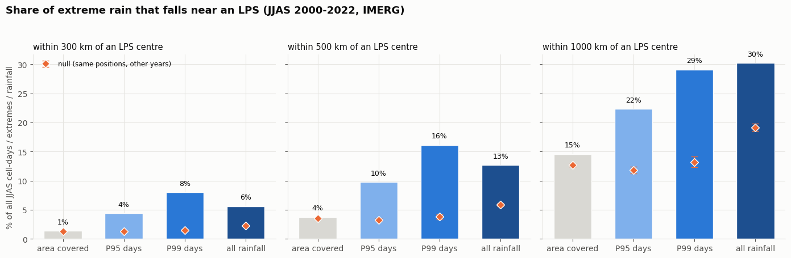
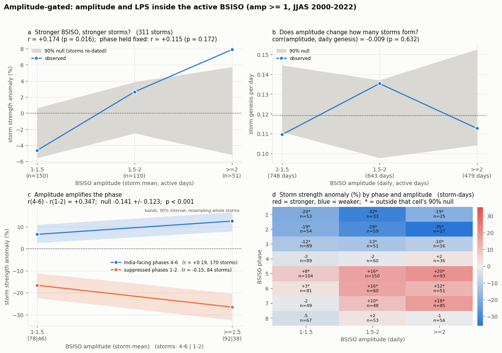
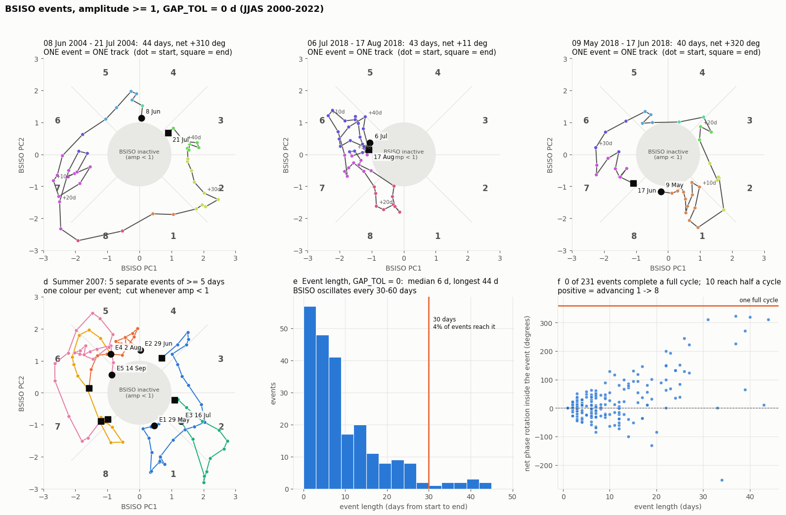
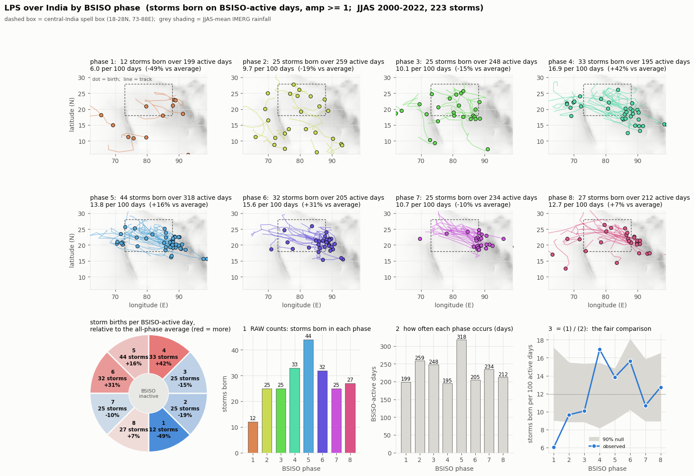

# BSISO and monsoon low-pressure systems (LPS): what the numbers say

Companion to [`bsiso_lps_analysis.ipynb`](../ipynb/bsiso_lps_analysis.ipynb) (a Kaggle notebook).
Season analysed: June-September (JJAS), 2000-2022.

Every number below is printed by the notebook. The notebook's code was also re-run separately on a
second copy of the same data, and the numbers matched. A few extra checks that are **not** in the
notebook are marked "outside the notebook".

---

## 1. The result in one paragraph

The phase of the boreal summer intraseasonal oscillation (BSISO) changes how **strong** monsoon
low-pressure systems are (strong evidence) and, more modestly, how **often** they form (moderate
evidence). BSISO **amplitude** does not change how often they form; it only amplifies the effect of the
phase on their strength. The storms carry the extreme rain: the heaviest rainfall days are several
times more likely close to a storm centre. Three ideas that looked plausible turned out **not** to be
supported (section 5).

### What is supported, and what is not

| claim | key number | verdict |
|---|---|---|
| BSISO phase changes LPS **strength** | strength anomaly runs from -27% to +15% by phase; p < 0.003 (all days), < 0.001 (amp >= 1); 6 of 8 phases outside chance | **strong** (one caveat, section 6) |
| BSISO phase changes LPS **genesis** | hump peaking near phase 5, about 30% above average; omnibus p = 0.019 (all days), 0.024 (amp >= 1) | **moderate** |
| Amplitude **amplifies** the phase effect on strength | r = +0.24 in phases 4-6 vs -0.31 in phases 1-2; p < 0.001 | **moderate** (weaker once amp >= 1 only) |
| Extreme rain **clusters** around LPS centres | within 500 km: 16% of the heaviest rain days in 3.8% of the area (4.3x) | **strong**, but expected physically |
| The phase calculation is correct | all 8 phase-day counts match the reference exactly (2,806 days) | **verified** |
| The BSISO **lingers** in phase 5 | 17.0% of active days vs 12.5% if flat; stays 3.8 days per visit vs 2.8-3.4 | **moderate**; a BSISO property, not a storm result |
| Amplitude changes how often storms **form** | r = -0.011, p = 0.34 (gated: -0.009, p = 0.63) | **no effect** |
| Amplitude **alone** changes strength | with phase held fixed: p = 0.082 (gated: 0.17) | **not supported** |
| A genesis-to-strength **lag** caused by the BSISO | explained by storm age (section 5) | **not supported** |
| One clean BSISO **track per summer** | strict events: about 10 per summer, none completes a cycle | **not supported** |

---

## 2. Data and terms

| dataset (Kaggle) | file | contents |
|---|---|---|
| BSISO index | `BSISO.INDEX.NORM.LY.data` | daily BSISO PC1, PC2 and amplitude, 1981-2026 (APCC index, Lee et al. 2013) |
| LPS tracks | `lps_daily_2000_2022.parquet` | 2,232 storm-days from 345 storms, JJAS 2000-2022: daily centre position and strength |
| IMERG rainfall | `imerg_india_025_jjas_2000_2024.nc` | daily rain (mm/day), 0.25 degree, 5-40N, 60-100E, 3,050 JJAS days |

The data files are not stored in this repository. *Source note: confirm and add the exact citation for
the LPS catalogue before sharing this publicly.*

| term | meaning |
|---|---|
| **phase** | one of 8 sectors of the (PC1, PC2) plane, `atan2(PC1, -PC2)`. Phases 4-6 are when the wave sits over India |
| **amplitude** | distance of (PC1, PC2) from the origin: how strong the BSISO is that day |
| **BSISO-active** | amplitude >= 1. Below 1 the BSISO is treated as inactive and its phase is noise. *Not the same as an "active rainfall spell"* |
| **genesis** | the first day of a storm's track |
| **strength** | minus the minimum streamfunction at the storm centre (bigger = stronger) |
| **storm-day** | one storm on one day. A 6-day storm gives 6 storm-days |
| **per 100 days** | storms born per 100 BSISO days in that phase. This divides out how often each phase occurs |

---

## 3. How to read the statistics

**The grey "null" band.** It shows what a curve looks like if the BSISO and the storms are unrelated.
Each storm is kept as one rigid object (position, duration, calendar date) and moved to the same date
in a randomly chosen different year. That breaks its timing against the BSISO but keeps the seasonal
cycle. The curve is recomputed, 1,000 times. The band is the middle 90% of those curves at each phase.
In the amplitude-gated analyses the gate is re-applied each time.

**A point inside its band** means that phase alone cannot be told apart from chance. About 10% of
points fall outside by luck, so with 8 phases about 0.8 are expected outside. The band is **not** a
test of the whole curve.

**p-values** come from this shuffling (never from textbook formulas, which are far too lenient for
multi-day storms). With 1,000 shuffles the smallest possible p is 0.001 (0.003 in the earliest cells,
which used 300), so "p < 0.001" means none of the shuffles matched the data.

**Two tests of the genesis curve:**
- *omnibus p*: do the 8 phase rates differ from a flat line? (decided in advance)
- *hump p*: is there one smooth hump around the phase circle? (added after looking at the data, so it
  supports but does not prove)

---

## 4. Results

### 4.1 The phase calculation is verified
Phase derived from PC1 and PC2 reproduces the reference phase-day counts exactly:
288, 401, 388, 322, 473, 299, 333, 302 for phases 1-8, total 2,806 (= 23 summers x 122 days).
One index day (2015-06-21) is missing and is filled by interpolation. On average the phase advances
1 -> 8: +66 degrees over 10 days (amp >= 1), but with a wide spread (R = 0.32).



### 4.2 Phase and storm genesis
Storms born per 100 BSISO days in each phase, with the 90% chance range:

| phase | all days: storms | per 100 d | chance range | | amp >= 1: storms | per 100 d | chance range |
|---|---|---|---|---|---|---|---|
| 1 | 19 | 6.6 | 9.4-15.3 **below** | | 12 | 6.0 | 9.0-16.6 **below** |
| 2 | 39 | 9.7 | 10.0-15.2 **below** | | 25 | 9.7 | 9.3-15.8 |
| 3 | 49 | 12.6 | 9.5-14.7 | | 25 | 10.1 | 8.9-15.7 |
| 4 | 48 | 14.9 | 9.0-14.6 **above** | | 33 | 16.9 | 8.2-15.9 **above** |
| 5 | 74 | 15.6 | 9.7-14.6 **above** | | 44 | 13.8 | 9.1-14.8 |
| 6 | 43 | 14.4 | 10.0-16.4 | | 32 | 15.6 | 10.2-17.6 |
| 7 | 36 | 10.8 | 9.3-15.0 | | 25 | 10.7 | 9.0-16.2 |
| 8 | 37 | 12.3 | 9.3-15.2 | | 27 | 12.7 | 9.0-16.5 |

| | storms | highest / lowest rate | omnibus p | hump p | hump peak at phase | phases outside chance |
|---|---|---|---|---|---|---|
| all days | 345 | 2.37x | 0.019 | 0.001 | 5.0 | 4 of 8 |
| amp >= 1 | 223 | 2.81x | 0.024 | 0.004 | 5.2 | 2 of 8 |

**Reading it.** Storms form most often when the wave is over India (phases 4-6) and least often in
phase 1. The effect is modest: most single phases sit inside their own chance range because each has
only 12-74 storms. The evidence is in the **shape of the whole curve** (the omnibus and hump tests),
not in individual points. Note that phase 5 has the most storms (74) partly because it is the most
common phase; the "per 100 days" column removes that.

*Outside the notebook:* the same hump shape was found in a separate, longer LPS catalogue (ERA5,
1981-2019): peak at phase 4.8-4.9, omnibus p = 0.0015. In the years 1981-1999 only (never used in this
notebook) it is also present: all days p = 0.019, amp >= 1 p = 0.041, peak at 4.8-4.9.



### 4.3 Phase and storm strength
Strength anomaly (% relative to the all-phase mean) by phase:

| phase | storm-days (all) | all days | amp >= 1 |
|---|---|---|---|
| 1 | 179 | -14.3 | **-23.2** |
| 2 | 237 | -19.2 | **-26.7** |
| 3 | 264 | -11.4 | -12.1 |
| 4 | 303 | +0.2 | -1.7 |
| 5 | 480 | +11.9 | **+14.7** |
| 6 | 263 | +8.9 | +9.6 |
| 7 | 255 | +9.2 | +10.4 |
| 8 | 251 | -1.2 | -1.7 |

p < 0.003 for all days (none of 300 shuffles matched) and p < 0.001 for amp >= 1 (none of 1,000); 6 of 8 phases lie outside their chance range in both. Storms are
**weaker** in phases 1-3 and **stronger** in phases 5-7. Restricting to amp >= 1 sharpens the contrast.



### 4.4 Amplitude
| statistic | all days | amp >= 1 |
|---|---|---|
| r(amplitude, storm strength) | +0.142 (p = 0.018) | +0.174 (p = 0.016) |
| same, **phase held fixed** | +0.104 (p = 0.082) | +0.115 (p = 0.172) |
| r in phases 4-6 | +0.243 | +0.195 |
| r in phases 1-2 | -0.307 | -0.152 |
| **interaction**, r(4-6) minus r(1-2) | **+0.551** (null -0.046 +/- 0.097), p < 0.001 | **+0.347** (null -0.141 +/- 0.123), p < 0.001 |
| r(daily amplitude, daily genesis) | -0.011 (p = 0.34) | -0.009 (p = 0.63) |

- **Genesis does not depend on amplitude.** Genesis per day by amplitude bin (< 1, 1-1.5, 1.5-2, >= 2)
  is 0.130, 0.110, 0.135, 0.113: all inside, or at the edge of, the chance band.
- **Amplitude amplifies the phase effect on strength.** In phases 4-6 a stronger BSISO means stronger
  storms; in phases 1-2 it means weaker storms. Alone, the amplitude effect is weak and not significant
  once phase is held fixed.
- The raw interaction numbers in the two columns are not comparable, because the null's centre moves
  when the gate is applied. The all-days result is about 6 standard deviations from its null, the
  amp >= 1 result about 4.



### 4.5 Rain around storm centres (IMERG)
"Extreme" means at or above a grid cell's own 95th or 99th percentile of JJAS daily rain (median
19.5 and 46.5 mm/day). The null is the same storm positions with rainfall taken from the same date in
a different year (100 draws).

| distance from centre | mean rain, storms vs null (mm/day) | P(95th-percentile day) | P(99th-percentile day) |
|---|---|---|---|
| 100-200 km | 23.8 vs 9.6 | 0.191 vs 0.054 (3.5x) | 0.063 vs 0.011 (5.6x) |
| 400-500 km | 14.8 vs 9.3 | 0.114 vs 0.053 (2.2x) | 0.028 vs 0.011 (2.6x) |
| 600-700 km | 10.4 vs 8.7 | 0.075 vs 0.052 (1.4x) | 0.014 vs 0.010 (1.4x) |
| 900-1000 km | 7.3 vs 7.6 | about 1x | about 1x |

Share of all extreme rain falling within a radius of any storm centre:

| radius | share of area | share of 99th-percentile days | null | enrichment |
|---|---|---|---|---|
| 300 km | 1.4% | 8.0% | 1.5% | 5.9x |
| 500 km | 3.8% | 16.1% | 3.8% | 4.3x |
| 1000 km | 14.6% | 29.1% | 13.2% | 2.0x |

p < 0.01 in each row (the floor for 100 shuffles). The enhancement fades by about 800-1000 km. This is
expected physically (the storms are rain-bearing, and the catalogue requires a moist core). The centres
come from reanalysis and the rain from a satellite estimate, so it is not a shared-input artefact. The
null still contains the average influence of storms at those places, so the true enrichment is probably
slightly larger.




### 4.6 Restricting to BSISO-active days (amp >= 1)
The BSISO is only defined as active when amplitude >= 1, so the phase is meaningless below that.
Gating keeps 1,870 of 2,806 days (67%), 223 of 345 storms (65%) and 1,489 of 2,232 storm-days (67%).

| | all days | amp >= 1 |
|---|---|---|
| genesis highest/lowest rate | 2.37x | 2.81x |
| genesis omnibus p | 0.019 | 0.024 |
| strength range by phase | -19% to +12% | -27% to +15% |
| strength p | < 0.003 | < 0.001 |

Gating **sharpens the contrast but weakens the evidence**, because a third of the storms are discarded.
It is the correct definition for describing phase behaviour, but not a way to get stronger statistics.
Storms born on inactive days (122 of 345) are a real part of the picture: the amplitude result above
says genesis does not depend on amplitude.



### 4.7 BSISO events: one track per event
An **event** starts when amplitude reaches 1 and ends when it drops below 1. The number of events
depends heavily on how long a dip below 1 is tolerated inside one event:

| dip tolerated (days) | events | per summer | median length (d) | reach 30 d | longest (d) | rotate >= 180 deg | rotate >= 360 deg |
|---|---|---|---|---|---|---|---|
| **0 (strict)** | 231 | 10.0 | 6 | 4% | 44 | 10 | **0** |
| 1 | 196 | 8.5 | 7 | 7% | 74 | 13 | 1 |
| 2 | 153 | 6.7 | 11 | 14% | 101 | 14 | 2 |
| 3 | 116 | 5.0 | 17 | 29% | 154 | 23 | 4 |
| 5 | 81 | 3.5 | 32 | 52% | 197 | 26 | 9 |
| 7 | 57 | 2.5 | 56 | 72% | 231 | 29 | 17 |

- Under the strict rule the BSISO splits into about **10 short events per summer**, and **none of 231**
  completes a full phase cycle.
- Tolerating dips does not fix it: at 5 days several separate waves fuse into one 197-day "event".
- No setting gives a clean "one event = one wave". The event definition is a choice that has to be
  stated; it is not a property of the index.
- Example, summer 2007 (strict, events of at least 5 days): 29 May-24 Jun (27 d, +123 deg),
  29 Jun-12 Jul (14 d, +86), 16-28 Jul (13 d, +23), 2-17 Aug (16 d, +93), 14 Sep-6 Oct (23 d, +69).
- *Outside the notebook (from the saved event table):* among events of 20 days or more, 27 of 30
  advance 1 -> 8 on average (median +130 deg). So longer events do follow the phase order, but none
  completes a full cycle.



### 4.8 Where storms form, by BSISO phase
Storms born on BSISO-active days, placed in the phase of their birth day:

| phase | storms | active days | born per 100 days | vs average |
|---|---|---|---|---|
| 1 | 12 | 199 | 6.0 | -49% |
| 2 | 25 | 259 | 9.7 | -19% |
| 3 | 25 | 248 | 10.1 | -15% |
| 4 | 33 | 195 | 16.9 | +42% |
| 5 | 44 | 318 | 13.8 | +16% |
| 6 | 32 | 205 | 15.6 | +31% |
| 7 | 25 | 234 | 10.7 | -10% |
| 8 | 27 | 212 | 12.7 | +7% |
| all | 223 | 1,870 | 11.9 | |

In phases 4-8 most storms form over the northern Bay of Bengal and eastern India and track
west-north-west across central India (read from the maps, not tested).



### 4.9 How often the BSISO sits in each phase (amp >= 1)

| phase | share of active days | 90% range | summers above 12.5% | stays (days per visit) |
|---|---|---|---|---|
| 1 | 10.6% | 8.3-13.2 | 6 of 23 | 3.1 |
| 2 | 13.9% | 11.2-16.7 | 13 of 23 | 3.3 |
| 3 | 13.3% | 10.6-16.4 | 9 of 23 | 3.1 |
| 4 | 10.4% | 8.1-12.8 | 10 of 23 | 2.9 |
| **5** | **17.0%** | **14.4-19.6** | **16 of 23** | **3.8** |
| 6 | 11.0% | 8.7-13.4 | 7 of 23 | 2.8 |
| 7 | 12.5% | 10.2-14.8 | 12 of 23 | 3.4 |
| 8 | 11.3% | 8.8-14.3 | 9 of 23 | 3.3 |

Flat would be 12.5% per phase. The ranges come from resampling whole summers. Phase 5 is the only
phase whose range excludes 12.5% from above, and the BSISO stays there longest. This is a feature of
the BSISO itself. It does **not** explain the genesis result, because the genesis rates are already
divided by the number of days in each phase.

---

## 5. Notes written in the notebook that the numbers do not support

| note in the notebook | what the numbers say |
|---|---|
| "LPS genesis is 2.4x more frequent when the BSISO is in phase 5 than in phase 1 (p = 0.017)" | Correct for all days (0.156 vs 0.066 per day = 2.37x). A later 1,000-shuffle run gives p = 0.019. With amp >= 1 the highest rate is in phase 4, and the ratio is 2.81x |
| "The genesis peaks in phases 4,5 and the lps intensity peaks in phases 5,6,7. A lag??" | **Not a BSISO lag.** The genesis curve uses the phase on the day a storm forms; the strength curve uses the phase on every storm-day, which on average is 3.8 days later (outside the notebook). That alone predicts about half to one phase of offset. Strength by the phase **at birth** peaks at phase 5, the same as genesis |
| "AMPLITUDE HAS NO EFFECT ON THE STORM FORMATION" | Supported: r = -0.011 (p = 0.34); amp >= 1: -0.009 (p = 0.63). Amplitude does, however, amplify the phase effect on strength |
| "Gating the BSISO by 1 amplitude gives stronger results about trajectory and genesis" | Partly. Gating sharpens the contrast (2.37x to 2.81x) but **not** the significance (p 0.019 to 0.024). For "trajectory", events fragment under the strict rule (section 4.7) |
| "The TRAJECTORY of BSISO ... to see if they follow phase ordering" | On average, longer events do advance 1 -> 8, but no event completes a cycle and the result depends on how an event is defined |

To check the storm-age claim:
```python
lps_sorted = lps.sort_values(["track", "date"])
age = (lps_sorted["date"] - lps_sorted.groupby("track")["date"].transform("min")).dt.days
age.mean()          # about 3.8 days
```

---

## 6. Caveats

- **Shared wind input.** The BSISO index is built partly from 850 hPa wind, and storm strength is the
  depth of the 850 hPa streamfunction. Part of the phase-to-strength result could therefore be the
  large-scale circulation itself and not the storms. Genesis (a count of events) is much less exposed.
  Two tests would settle it and are **not done**: using the phase from 5-10 days before the storm,
  and using a strength measure that removes the background flow (pressure drop, which needs a different LPS catalogue than the one in this notebook).
- **Many tests.** The project has run dozens of tests. p-values of 0.02-0.04 would not survive a
  correction for that, so no single genesis p-value should be presented as decisive.
- **The hump test** was added after looking at the data.
- **Event definition** is undecided (section 4.7).
- **Storm tracks are not independent** from day to day, so day-level tests would be wrong. All
  p-values use whole-storm shuffling.
- **Sample size.** 345 storms (223 when gated); per-phase numbers are small.

---

## 7. Reproducing

1. Attach the three Kaggle datasets listed in section 2.
2. Run the notebook top to bottom. Early cells define the data and helper functions that later cells
   reuse, so the order matters.
3. Random seeds are fixed in each cell. Changing the number of shuffles (`N_PERM`) changes the
   p-values slightly. Setting `AMP_MIN = 0` in the gated cells removes the gate.

Reference for the index: Lee, J.-Y., et al. (2013), Real-time multivariate indices for the boreal
summer intraseasonal oscillation over the Asian summer monsoon region, *Climate Dynamics*, 40, 493-509.
