# BSISO, rain spells and extreme rain: what the plots say

Companion to [`bsiso_rain_plots.ipynb`](bsiso_rain_plots.ipynb) (a Kaggle notebook).
Season analysed: June-September (JJAS), 2000-2024. Anything involving storms (LPS) uses 2000-2022.

The first part repeats the figures of Dey et al. (2022, *Theor. Appl. Climatol.* 148, 819-831), which
compared the MISO and MJO indices, but using the BSISO index and our own active/break spells. The second
part asks the same questions for extreme rainfall events (EREs) from our summer tracking catalogue.

Numbers in tables are printed by the notebook. A few numbers are read off the figures; those are marked
"(from the figure)".

---

## 1. The result in one paragraph

The BSISO is a slow band of cloud and rain that moves north over India every 30-60 days. When it is over
central India (BSISO1 phases 5-6), active wet spells are about twice as common and large extreme-rain systems
are 2-3 times as common there. When it is over the Northeast instead (phases 2-3), the Northeast gets the
large extremes and central India goes quiet. Storms (low-pressure systems) pile up at the start of an active
spell and vanish at the start of a break. But the BSISO does **not** make an individual storm rain harder
than is normal for that place: it controls **how often large, organised rain systems form**, not how intense
they are. The bigger the event, the stronger its link to the BSISO.

### What is supported, and what is not

| claim | key number | verdict |
|---|---|---|
| Active days crowd into BSISO1 **phase 5** | 36% of active days vs 17% of all days (from the figure) | **clear** |
| Break days lean to phases 7-8 | about 19% each vs 12% (from the figure) | **weak** |
| The rain band **moves north** with the phase | wet band at ~10N in phases 2-3, inside 18-28N in phases 4-6 (from the figure) | **clear** |
| Storms come with active spells, leave with breaks | storm near central India on ~88% of spells 2 days after active onset vs ~16% after break onset (from the figure) | **clear** |
| The BSISO **moves** extreme rain around India | Central India p = 0.007, Northeast p = 0.005; all-India total p = 0.40 | **supported** |
| Multi-day EREs start more often in phase 5 | 1.73x the average; pattern p = 0.007 | **supported** |
| **Large** EREs are much more common in the BSISO's own phases | 16+ cells: x2.14 (Central India), x2.36 (Northeast); 30+ cells: x2.61, x4.87; all p <= 0.009 | **strong** |
| Large EREs are **fewer** when the BSISO is away | Central India 16+ cells x0.69 (p = 0.001) | **supported** for Central India, noisy for the Northeast |
| Each event is **more intense** for its location | rain / local threshold: x1.011 (Central India), x0.999 (Northeast) | **not supported** |
| The raw "10% heavier rain" in the right phase | explained by **where** the events fall, not by stronger storms | **location effect** |

---

## 2. Data and terms

| dataset (Kaggle) | file | contents |
|---|---|---|
| IMERG rainfall | `imerg_india_025_jjas_2000_2024.nc` | daily rain (mm/day), 0.25 degree, 5-40N, 60-100E, 3,050 JJAS days |
| BSISO index | `BSISO.INDEX.NORM.LY.data` | daily BSISO1 (PC1, PC2) and BSISO2 (PC3, PC4), 1981-2026 (APCC index, Lee et al. 2013) |
| LPS tracks | `lps_daily_2000_2022.parquet` | 345 storms, JJAS 2000-2022 |
| OLR | `olr_cbo_jjas_2000_2024_30S45N_30E130E.nc` | daily outgoing longwave radiation (cloudiness), a cut-down copy of the CPC blended OLR |
| India mask | `india_mask_025.npy` | India land cells on the IMERG grid |
| ERE catalogue | `objdays_enriched.parquet`, `tracks_enriched.parquet` | 10,877 extreme-rain object-days and 10,006 tracks from the summer tracker |

The data files are not stored in this repository.

| term | meaning |
|---|---|
| **active / break spell** | central-India land rain (18-28N, 73-88E) at least 1 standard deviation above / below normal for that date, for 3+ days in a row |
| **onset** | the first day of a spell (or of an ERE) |
| **phase** | one of 8 sectors of the BSISO (PC1, PC2) plane. Phases 4-6 = the rain band over India |
| **amplitude** | how strong the BSISO is. Below 1 it is treated as weak (inactive) |
| **ERE** | extreme rainfall event: touching grid cells whose rain is above that cell's own 99th percentile of wet days (at least 50 mm/day) |
| **ERE size** | number of 0.25 degree grid cells (1 cell is about 750 km2; 16 cells about 12,000 km2) |
| **rain / local threshold** | an event's rain divided by the normal extreme for the cells it covers. It removes the effect of *where* the event is |
| **its phases** | the phases when the BSISO rain band is over that region: 5-6 for Central India, 2-3 for the Northeast |

---

## 3. How to read the statistics

- **Ratios**: 1.00 means "same as average". x2 means twice as often.
- **p-values come from re-dating whole seasons**: each summer's rain is paired with another summer's BSISO,
  1,000 times. This keeps the day-to-day clustering of rain and asks how often chance alone gives a pattern
  as strong. No textbook formulas are used.
- **Grey or shaded bands** in figures are this chance range (90%).
- **Holm correction** is applied where several measures were tried at once.

---

## 4. Results

### 4.1 Spells (paper Table 1)

| spell | spells | total days | mean length | longest |
|---|---|---|---|---|
| active | 73 | 285 | 3.9 days | 12 days |
| break | 61 | 304 | 5.0 days | 13 days |

Long active spells are rare in IMERG 2000-2024: only 18 last 5 days or more (28 for breaks). The paper used
spells of 7+ days; here 5+ days is used to have enough examples.

### 4.2 Spell days in BSISO phase space (paper Fig 1-2)

Each dot is one active (or break) day placed at that day's BSISO. The bars show the share of spell days in
each phase; the diamonds show the share expected if the BSISO had no link to the spells.

- **Active days**: phase 5 holds about 36% of them, against 17% expected. Phases 1-3 are well below
  expected.
- **Break days**: lean to phases 7-8 (about 19% each, against 12%), and avoid phases 4-5.
- **BSISO2** (the faster 10-30 day mode) shows a weaker version of the same picture.

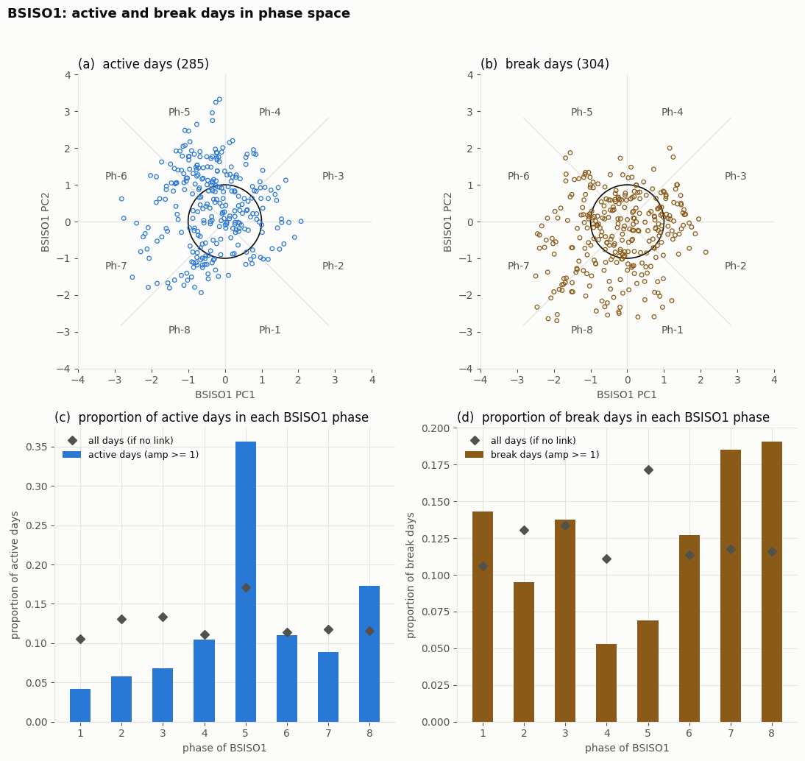
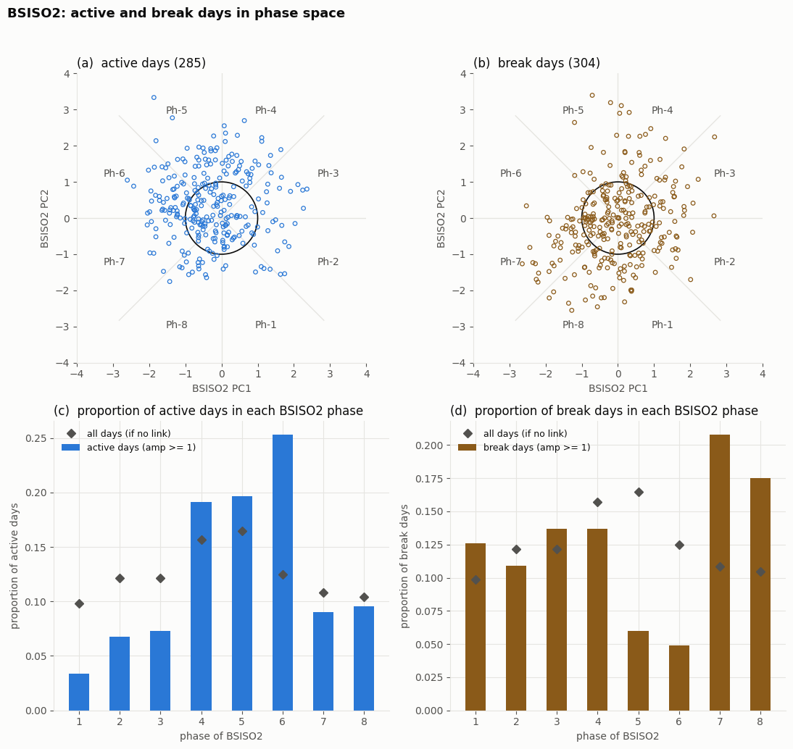

### 4.3 Rain and cloud for each phase (paper Fig 3-6)

Average rain anomaly maps for each of the 8 phases (10 June - 15 September, amplitude >= 1), and the same
for OLR (blue = more cloud and rain).

- The rain band starts over the southern ocean and southern India in phases 1-3, sits over central India in
  phases 4-6, and moves to the foothills and Northeast in phases 7-8, while central India dries.
- The **Hovmoller** plots (latitude against phase) show this as a diagonal band moving north. The dashed lines
  mark the spell box (18-28N): it is wet in phases 4-6 and dry in phases 8-2.
- OLR shows the same band starting south of the equator and moving north to about 25N.

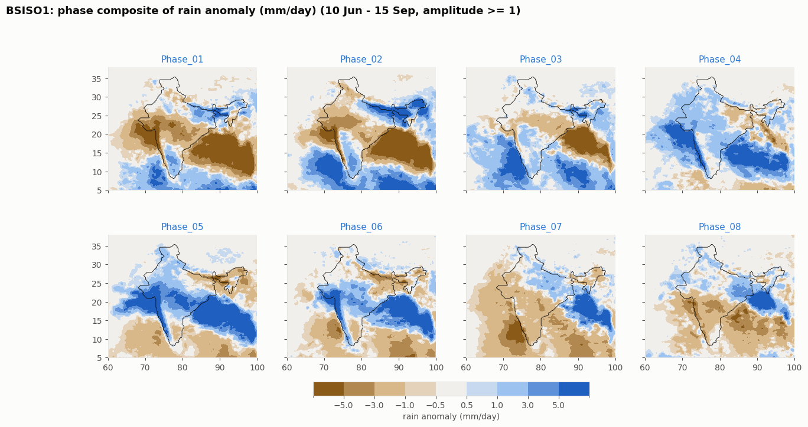
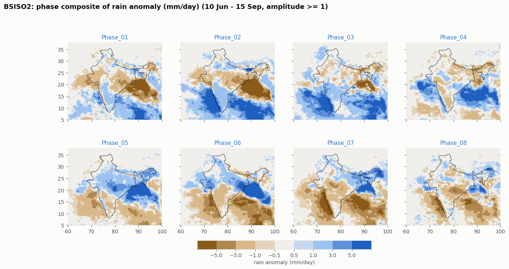
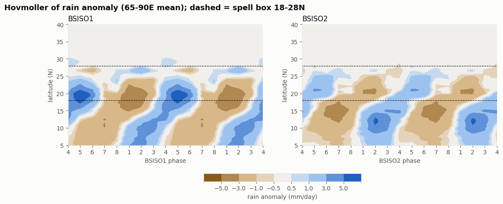
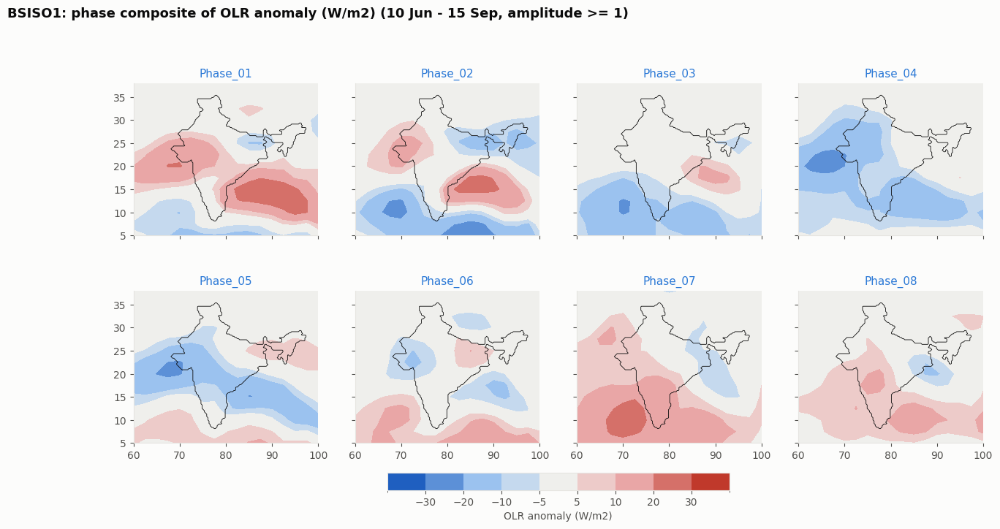
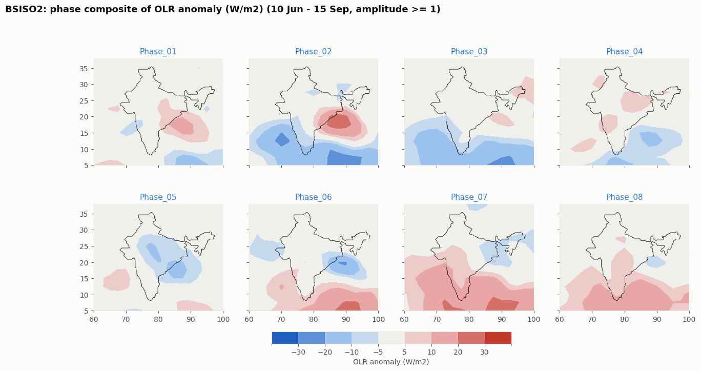
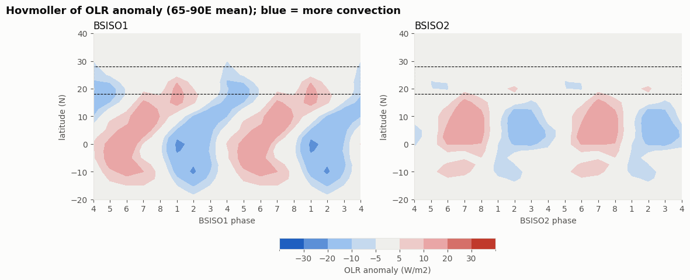

### 4.4 Rain rebuilt from the BSISO alone (paper Fig 7-8)

Rain at every grid cell rebuilt as *rain = b0 + b1 x PC1 + b2 x PC2* (the paper's equation 1). This is the
part of the rain that the BSISO alone can describe. It shows the same northward march, more smoothly, but
weaker than the real rain: on any given day most of the rain is not explained by the BSISO.

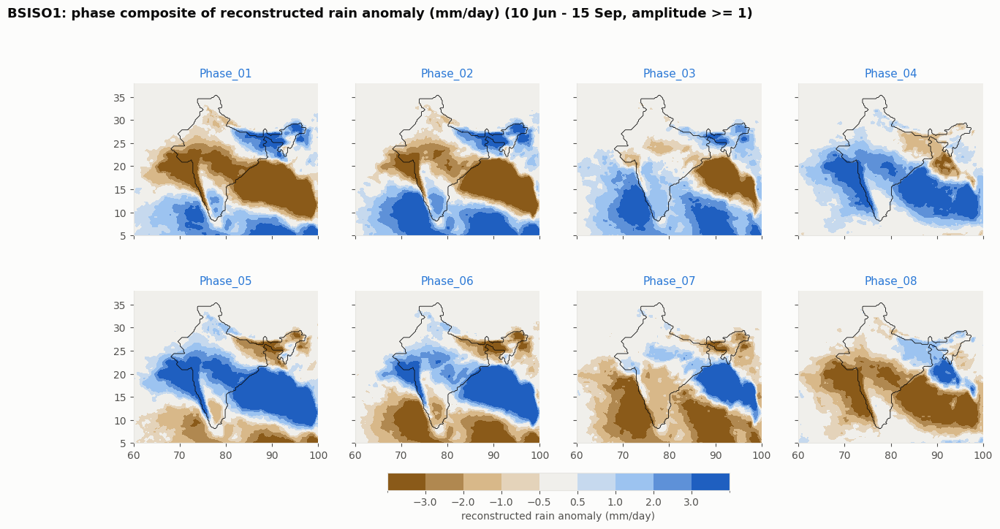
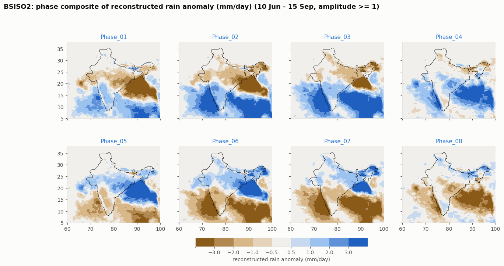
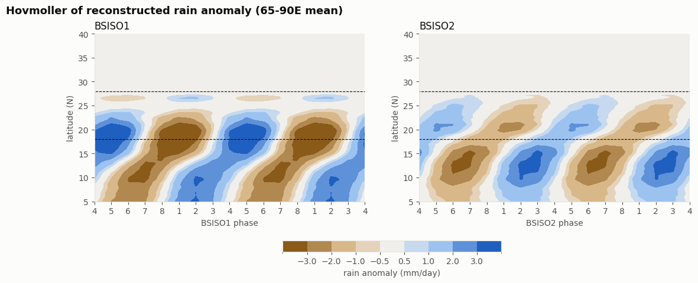

### 4.5 Each long spell's path in phase space (paper Fig 10-11)

One panel per spell of 5+ days: coloured = spell days, black dot = first day, grey = 5 days before and after.

- About a third of the long active spells sit in phases 5-6 with a strong BSISO and move anticlockwise
  through them, as expected.
- About a third begin with the BSISO weak (inside the circle): those spells were not set off by the BSISO.
- The rest happen in phases far from India.

So the BSISO sets up some long spells, but far from all of them.

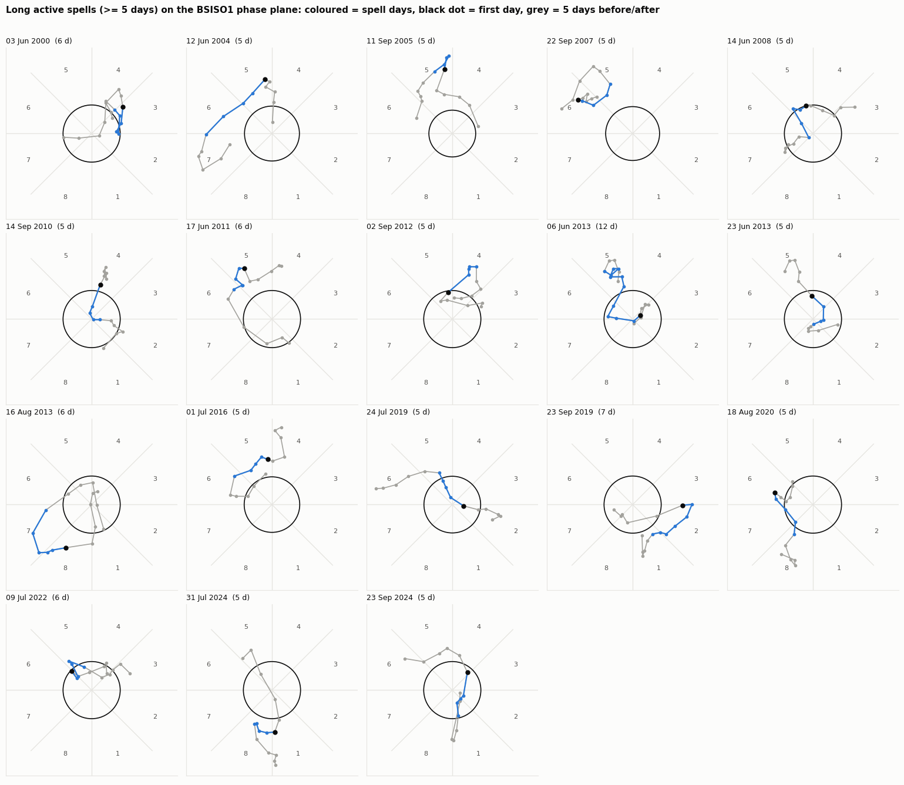
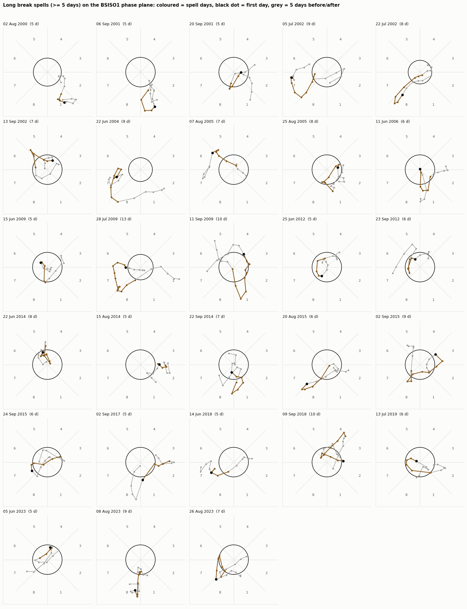

### 4.6 How a spell develops with the BSISO

The average BSISO path from 15 days before to 15 days after the start of a spell (73 active, 61 break).

- **Active spells**: the BSISO moves steadily through phases 3 -> 5, starts the spell at the phase 5-6 border,
  and carries on into 7-8. The spell starts about 5 days after the BSISO enters phase 5.
- **Break spells**: the path before the start is short and wobbly; the break starts in phases 7-8 and the
  BSISO then moves on through 1-2.
- **Rain**: the wet band moves north from about 15N into the spell box over the 5 days before an active
  spell starts.
- **Storms**: a storm near central India is present for about 45% of active spells two weeks before onset,
  rising to about 88% two days after it; for breaks it falls from about 74% to about 16% (from the figure).

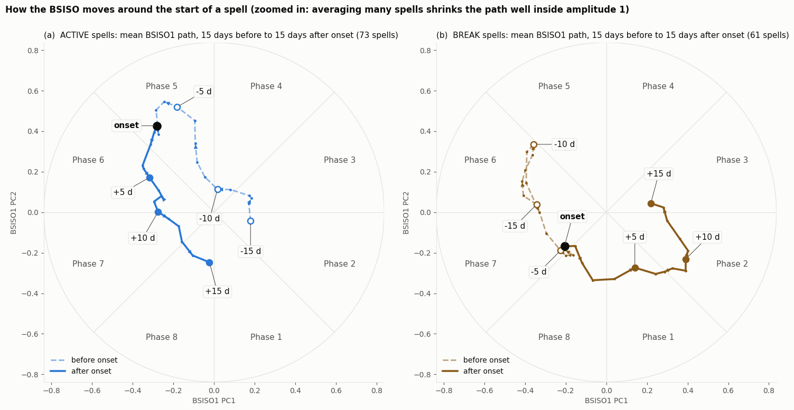
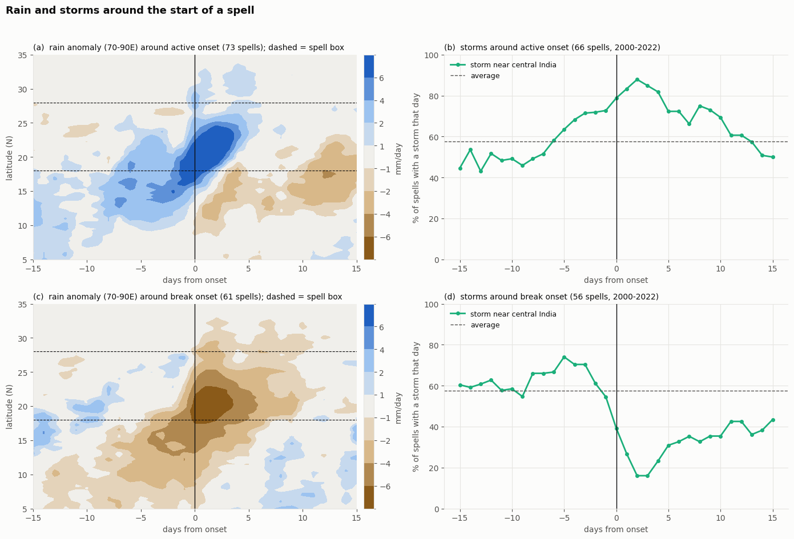

### 4.7 Extreme rain (ERE) by phase and region

ERE object-days in each BSISO1 phase compared with an average day (1.00 = average):

| | ph1 | ph2 | ph3 | ph4 | ph5 | ph6 | ph7 | ph8 | pattern p |
|---|---|---|---|---|---|---|---|---|---|
| All India | 0.97 | 1.14 | 0.99 | 0.89 | 1.06 | 1.13 | 0.98 | 1.06 | 0.404 |
| Central India | 0.81 | 0.94 | 0.80 | 0.81 | **1.24** | **1.31** | 1.06 | 1.10 | **0.007** |
| Northeast | 1.01 | **1.51** | **1.23** | 0.94 | 0.73 | 0.77 | 0.88 | 1.16 | **0.005** |
| Western Ghats | 1.24 | 1.38 | 0.99 | 0.94 | 1.25 | 1.13 | 0.78 | 0.70 | 0.074 |
| Himalayan foothills | 0.93 | 0.87 | 1.07 | 0.95 | 0.99 | 1.05 | 1.25 | 1.26 | 0.768 |
| Multi-day EREs (3+ days), first days | 0.63 | 1.24 | 0.64 | 0.69 | **1.73** | 1.43 | 1.47 | 0.74 | **0.007** |

The BSISO does not change how much extreme rain India gets in total (p = 0.40). It **moves** it: Central India
in phases 5-6, the Northeast in phases 2-3.

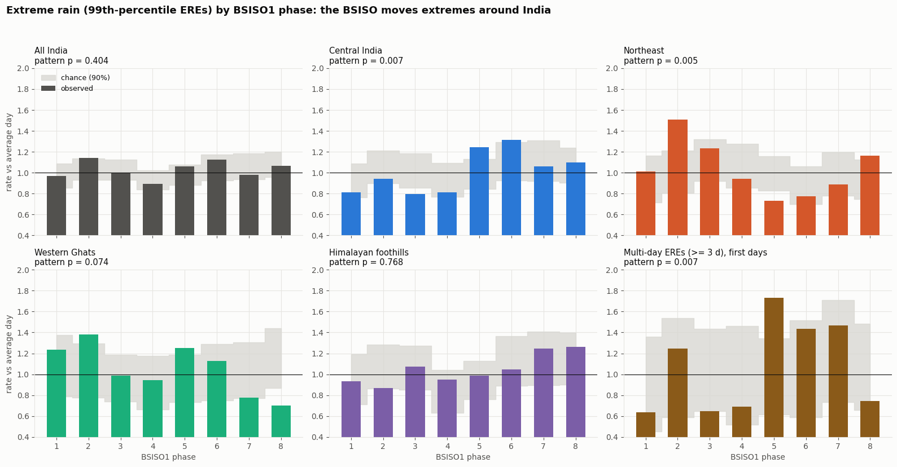

Where the 156 multi-day EREs start on the phase plane: Central India events crowd into phase 5 (18 of 67), and
Northeast events into phase 2 (9 of 32). Events close to a storm (LPS) sit mostly in phases 5-7.

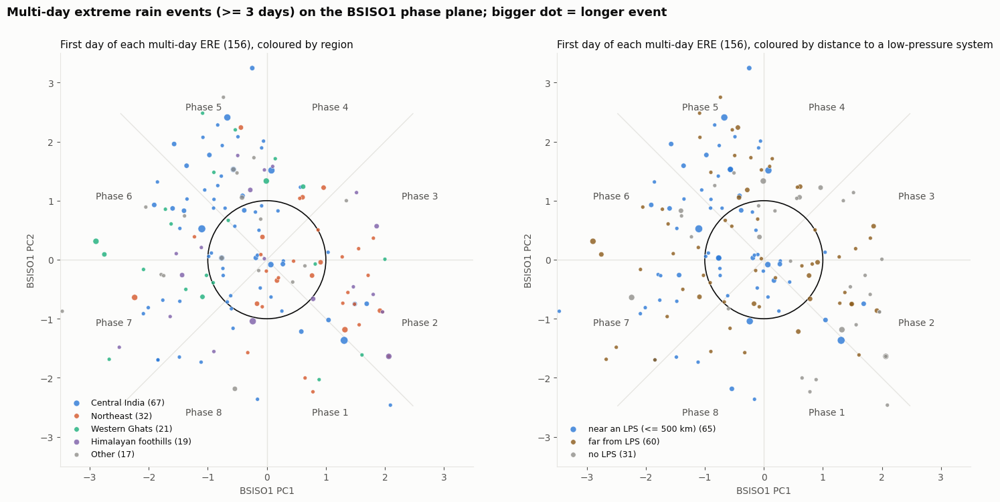

The average BSISO path around the start of an ERE: Central India events follow the same path as active
spells (phase 4 -> 5 before, onset at phase 6). Northeast events start in phases 2-3, the time when central
India is usually in a break.

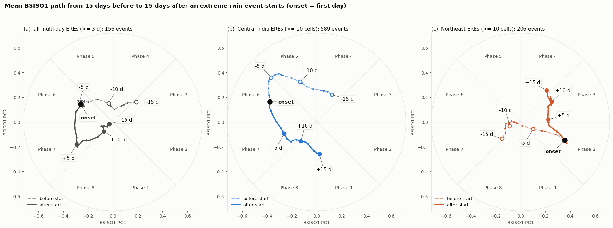

ERE rate by phase **and** strength (rings = BSISO amplitude). This figure is a picture only; it is not tested
against chance.

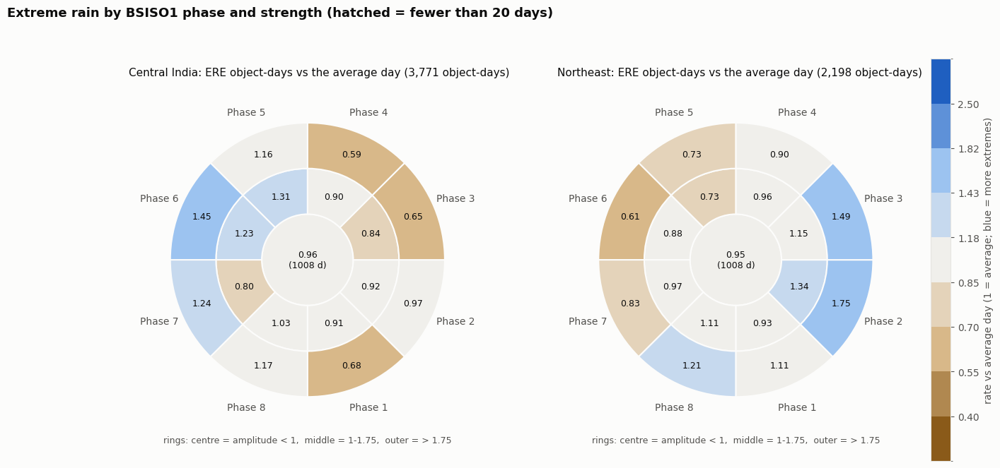

### 4.8 Is each extreme event stronger in the BSISO's own phase?

The frequency results above are partly expected from how the BSISO index is built: the index *is* the
large-scale cloud band, so more rain where the band is, is not a surprise. A stricter question is: **given
that an extreme event happens, is it stronger?** The strength of each event is not part of the index.

| region | measure | in its phases | other phases | BSISO weak | boost | p (Holm) |
|---|---|---|---|---|---|---|
| Central India | peak rain (mm/day) | 94.9 | 86.3 | 90.4 | x1.10 | 0.010 |
| | **rain / local threshold** | 1.11 | 1.10 | 1.11 | **x1.011** | 0.072 |
| | peak rain, 1-cell events only | 79.9 | 76.9 | 78.3 | x1.04 | 0.010 |
| | track peak size (cells) | 10.9 | 6.4 | 7.3 | x1.70 | 0.010 |
| | track duration (days) | 1.14 | 1.07 | 1.10 | x1.07 | 0.010 |
| Northeast | peak rain (mm/day) | 104.5 | 96.3 | 97.7 | x1.09 | 0.072 |
| | **rain / local threshold** | 1.12 | 1.12 | 1.12 | **x0.999** | 0.712 |
| | peak rain, 1-cell events only | 88.0 | 80.9 | 83.3 | x1.09 | 0.072 |
| | track peak size (cells) | 5.4 | 3.8 | 4.6 | x1.40 | 0.010 |
| | track duration (days) | 1.13 | 1.07 | 1.09 | x1.06 | 0.010 |

- Raw peak rain is about 10% higher in the right phase, but this **disappears** once each event is compared
  with the normal extreme for its own location (x1.011 and x0.999). So events are not more intense; in the
  right phase they simply fall where heavy rain is normal.
- Events are larger and last a little longer. In absolute terms the average size change (6 -> 11 cells) is
  small, because most EREs are tiny; section 4.9 looks at large events directly.
- Suppression away from the phase is weak: only Central India peak rain drops (x0.955, p = 0.001).

The relative intensity is computed inside the notebook by rebuilding every ERE from IMERG with the tracker's
own rule; the rebuilt objects match the catalogue on 99.7% of object-days.

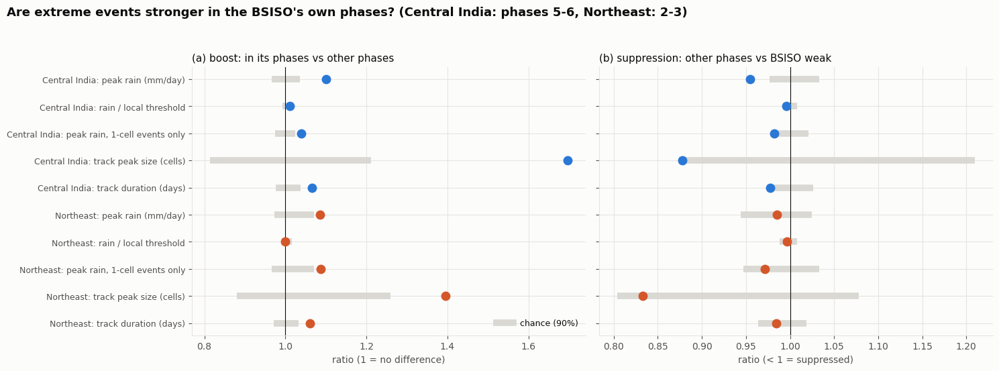

### 4.9 The bigger the event, the stronger the BSISO link

How much more often EREs **start** in the BSISO's own phases, by minimum event size:

| minimum size | Central India: events | more in its phases | fewer away | Northeast: events | more in its phases | fewer away |
|---|---|---|---|---|---|---|
| all | 3,466 | x1.31 | x0.96 | 2,011 | x1.44 | x0.96 |
| 4+ cells (~3,000 km2) | 1,254 | x1.51 | **x0.85** | 579 | x1.87 | x0.82 |
| 8+ cells (~6,000 km2) | 705 | x1.86 | **x0.77** | 273 | x2.18 | x0.99 |
| 16+ cells (~12,000 km2) | 405 | **x2.14** | **x0.69** | 110 | **x2.36** | x0.75 |
| 30+ cells (~22,000 km2) | 213 | **x2.61** | **x0.75** | 36 | **x4.87** | **x0.38** |

"More in its phases" beats chance at every size (p <= 0.009). "Fewer away" (compared with a weak BSISO) is
bold where p < 0.05. Rain relative to the local threshold stays between x0.99 and x1.02 at every size (only
the noisy 30+ cell Northeast value, x0.93, falls outside), and only one of the ten values beats chance
(Central India, all sizes: x1.011, p = 0.029).

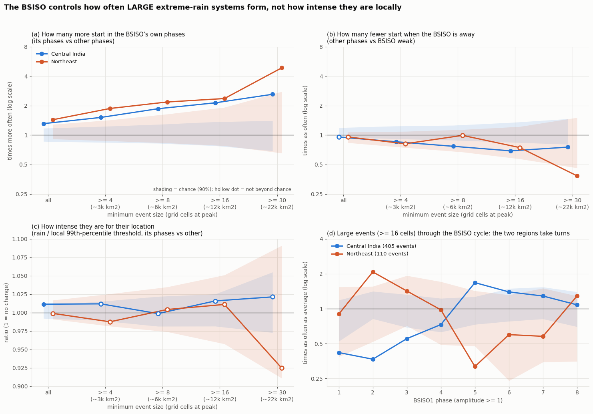

Small, one-cell extremes barely notice the BSISO. Large, organised extreme systems are 2-5 times more common
when the BSISO is over their region, and fewer than usual when it is away. Through the BSISO cycle the two
regions take turns (panel d of the figure).

---

## 5. Caveats

- **Partly by construction.** The BSISO index is built from cloudiness (OLR) and winds, so "more rain where
  the BSISO cloud band is" is expected. The parts that are not automatic are: the size dependence (large
  systems respond far more than small ones), the timing (spells start about 5 days after the BSISO arrives),
  and the storm behaviour (storms are not part of the index).
- **The size thresholds were chosen after seeing the data.** The whole curve (section 4.9) is shown for that
  reason; the trend is steady across all sizes.
- **Low variance explained.** On any single day, most of the rain is not described by the BSISO (section 4.4).
  The BSISO shifts the odds; it does not decide the weather.
- **Few long spells** (18 active spells of 5+ days in 25 years), so section 4.5 is descriptive.
- The 850 hPa wind arrows and vorticity of the paper's figures are not reproduced (no wind data used here).

---

## 6. What this means for the project

The BSISO's **phase** tells you where and how often large, organised extreme rain systems and wet spells
will form, and storms move with it. It does not tell you how intense a single storm will be. For forecasting,
this means a BSISO forecast should get the **phase** right about 5-10 days ahead, and its most useful target
is the chance of a large extreme-rain system or an active spell in week 2, not the rain amount of a single
event.
